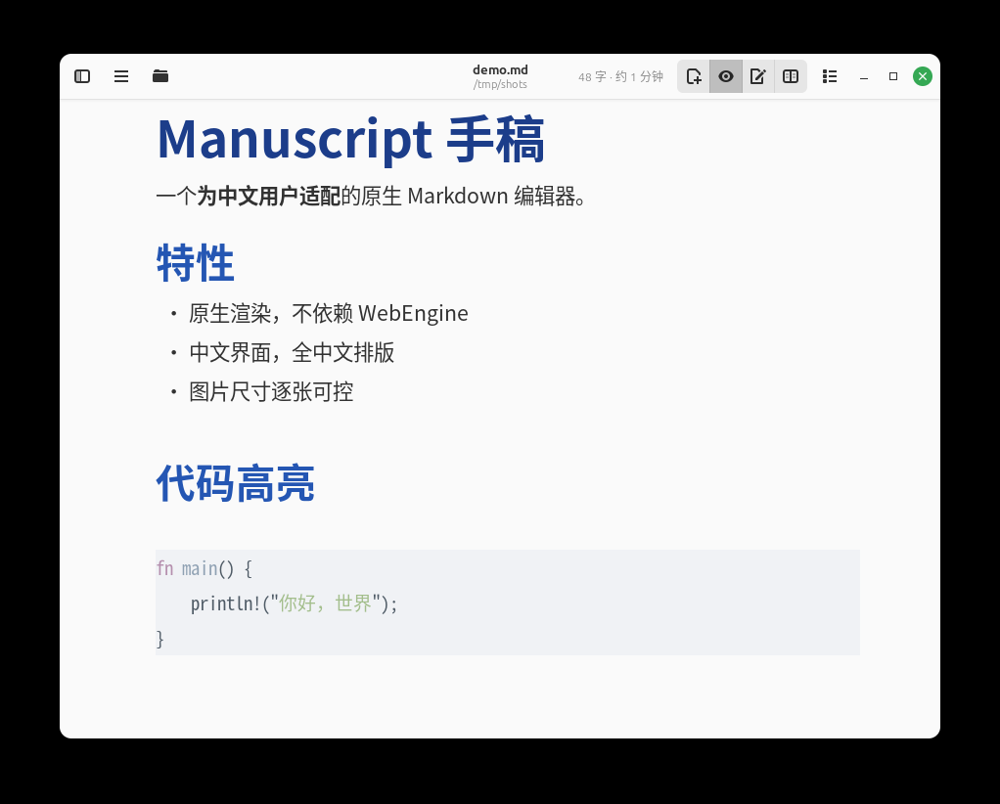
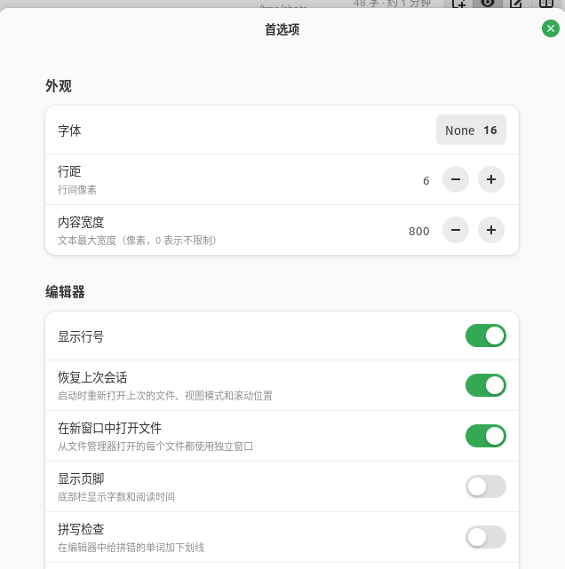

<div align="center">


# Manuscript 手稿

**原生 Markdown 编辑器 · 简体中文适配版**

基于 [Manuscript](https://gitlab.com/ilshat-apps/manuscript) 的衍生作品，为其补齐中文界面、逐张图片尺寸控制与文件选择器修复。

[](https://www.gnu.org/licenses/gpl-3.0)
[](https://www.rust-lang.org)
[](https://gtk.org)
[]()

[特性](#特性) · [截图](#截图) · [安装](#安装) · [图片尺寸](#图片尺寸逐张控制) · [与上游的差异](#与上游的差异) · [开发](#开发)

</div>

---

## 这是什么

**Manuscript** 是一个用 **Rust + GTK4/libadwaita** 编写的原生 Markdown 阅读与编辑器。
它**不使用 WebEngine**，直接用 Pango 排版，因此启动瞬时完成、内存占用只有 Electron 类编辑器的零头。

本项目（`manuscript-zh`）是它的**简体中文适配衍生版**，解决中文用户实际遇到的三个问题：

| 问题 | 上游现状 | 本版 |
|------|---------|------|
| 界面全是英文 | 无 i18n 基础设施，无法切换 | ✅ 完整简体中文界面 |
| 图片永远很小，改不大 | 宽度硬编码 360 px，`width` 属性被丢弃 | ✅ 逐张图片尺寸可控 |
| 文件选择器报错、应用卡死 | 依赖系统 portal，后端损坏即失效 | ✅ 改用 GTK 自绘选择器 |

## 特性

### 中文适配

- **完整中文界面** — 109 条界面字符串 + 20 条快捷键说明 + 页脚统计单位
- **中文排版正确** — CJK 断行由 Pango 处理，标点禁则正常，中英混排无额外空格
- **页脚统计中文化** — 显示「48 字 · 约 1 分钟」，而非「48 words · 1 min」
- **桌面菜单中文名** — `Manuscript 手稿`
- **中文输入法可用** — GTK4 原生支持 fcitx5 / ibus

### 图片尺寸逐张控制

- **两种写法** — Markdown 扩展语法 或 HTML `width` 属性
- **像素与百分比** — `{width=640}`、`{width=45%}`、`{height=300}`
- **全局默认可调** — 首选项里拖动调节，只影响未指定尺寸的图
- **不放大、不溢出** — 小图保持原样，超宽自动收敛到内容区

### 继承自上游的优秀特性

- **三种视图** — 阅读 / 编辑（GtkSourceView）/ 分栏实时预览
- **原生渲染** — 代码块高亮 100+ 语言、GFM 表格、任务列表、提示块（callout）、wiki 链接
- **笔记库侧栏** — 文件夹树、`[[wikilink]]` 解析、点击跳转或新建
- **全文搜索与替换** — `Ctrl+F` / `Ctrl+H`，实时匹配计数
- **写作模式** — 免打扰全屏（F11）、专注模式、打字机模式
- **导出 PDF** — 用同一套排版引擎生成 A4 PDF，无需 pandoc/LaTeX
- **多窗口、拖放、文件监视、最近文件、拼写检查**

## 截图

<div align="center">

**中文界面 · 阅读模式**



**中文首选项**



</div>

## 项目来源与致谢

> **本项目是基于他人开源作品的衍生作品，必须在此明确说明。**

- **原作者**：**Ilshat Ishdavletov**（[@ilshat-apps](https://gitlab.com/ilshat-apps)）
- **上游仓库**：<https://gitlab.com/ilshat-apps/manuscript>
- **上游许可**：[GPL-3.0-or-later](https://www.gnu.org/licenses/gpl-3.0.html)
- **上游版本**：**v1.6.2**（commit `52d7446`，2026-11-02）
- **Flathub**：[io.gitlab.ilshat_apps.manuscript](https://flathub.org/apps/io.gitlab.ilshat_apps.manuscript)

**本项目保留原作者的版权声明，并同样以 GPL-3.0-or-later 发布。**
上游的架构设计、Markdown 渲染管线、GTK 交互实现等绝大部分工作均由原作者完成；
本仓库只做下述增量改动。**若要体验原汁原味的版本，请优先使用上游项目或其 Flathub 包。**

## 我做了什么

相对于上游 v1.6.2，本项目的改动集中在三个方向，共约 **900 行新增 / 200 行修改**：

### 1. 简体中文本地化（`scripts/apply-zh-cn.py`）

上游**没有 i18n 基础设施**——我核实过四点：`Cargo.toml`/`Cargo.lock` 中 gettext 依赖为 0、
仓库无 `po/` 目录、源码无 `bindtextdomain`/`setlocale`、上游 issue 中零条翻译需求。
因此**不存在「打开开关就变中文」的可能**，中文只能在编译期替换字符串。

我把替换固化成幂等脚本而非手工改代码：

- 只替换完整的**字符串字面量**，跳过注释、raw string、字符字面量
- 规避 CSS 类名、GTK 标签名、action 名、文件扩展名等非 UI 字符串
- 每条替换断言命中次数，上游文案变动时会明确报告而非静默错位
- 可重复执行（`--check` 查看状态），可回滚

覆盖范围：窗口 tooltip 62 条、首选项 45 条、快速打开 2 条、快捷键窗口 20 条、页脚单位 3 处。

### 2. 逐张图片尺寸控制（`src/renderer.rs`，+672 行）

**问题定位**：上游 `const MAX_IMAGE_WIDTH: i32 = 360` 把图片宽度写死，
且 `html_img_sources()` 解析 `` 时**只取 `src`、丢弃 `width`/`height`/`style`**。
实测四种写法（Markdown、`width`、`width="100%"`、`style`）渲染宽度**完全相同**。

**实现**：

- 新增 `ImageSize` / `SizeSpec` 类型，按「显式宽度 → 显式高度 → 自然尺寸」优先级求解
- 新增 `expand_image_sizes()` 预处理，把 `{width=640}` 重写为标准 ``，
  复用同一条 HTML 渲染路径——两种语法只有一个实现
- 重写 `parse_html_images()`，完整解析大小写不敏感的 `width`/`height`/`style` 属性
- 改造 `load_local_image()` 返回**自然尺寸**（原实现返回已缩放尺寸，导致外层永远算错），
  并按实际显示宽度解码，避免大图占用数十 MB
- 全局默认上限接入 `config.max_image_width` + 首选项 SpinRow

### 3. 文件选择器修复（`src/window.rs`）

**问题**：在 Linux Mint 22.3 / Cinnamon 上，点击导出 PDF 弹出「**无法显示文件夹内容 / 操作被取消**」并卡死。

**根因取证**：我用 10 行纯 GTK4 探针程序做对照实验，证明这与本项目无关：

| 选择器类型 | 结果 |
|-----------|------|
| `GtkFileChooserNative`（走 xdg-desktop-portal → xapp） | ❌ 报错 |
| `GtkFileChooserDialog`（GTK 自绘） | ✅ 正常列目录 |

系统 `xdg-desktop-portal-xapp 1.1.3` 后端已损坏，**任何** GTK4 应用都受影响。

**修复**：4 处全部改用 GTK 自绘选择器，并统一在 `make_file_chooser()` 中处理销毁时序
（先隐藏、下一轮主循环再 destroy，避免调用方回调读取已释放对象）。

### 4. 工程配套

- `scripts/build-install.sh` — 一键检查依赖 → 应用翻译 → 编译 → 安装
- `README.md` / `README.zh-CN.md` — 中文文档
- `test-zh.md` / `test-image-size.md` — 中文渲染与图片尺寸自测文档
- 新增 **16 个单元测试**（总计 50 个），覆盖尺寸解析、语法转换、代码块不误伤、边界收敛

## 与上游的差异

| 方面 | 上游 v1.6.2 | 本项目 v1.6.3-zh.1 |
|------|-------------|-------------------|
| 界面语言 | 英文（硬编码） | 简体中文 |
| 图片宽度 | 固定上限 360 px | 逐张可控 + 全局默认 900 px |
| 图片语法 | 仅 `` | 额外支持 `{width=...}` / `{height=...}` |
| HTML `width` | 被忽略 | 生效（含百分比、`style`） |
| 文件选择器 | `GtkFileChooserNative`（依赖 portal） | `GtkFileChooserDialog`（不依赖 portal） |
| 单元测试 | 34 个 | 50 个 |
| 应用 ID | `io.gitlab.ilshat_apps.manuscript` | 保持不变（便于替换安装） |

## 安装

### 方式一：下载预编译二进制（最快）

前往 [Releases](https://github.com/FlyingDriver/manuscript-zh/releases) 下载最新的
`manuscript-zh-v*-linux-x86_64.tar.gz`，解压后安装：

```bash
tar xzf manuscript-zh-v1.6.3-zh.1-linux-x86_64.tar.gz
cd manuscript-zh-v1.6.3-zh.1-linux-x86_64
sudo ./install.sh          # 安装到 /usr/local
# 或
PREFIX=$HOME/.local ./install.sh   # 安装到用户目录，无需 root
```

启动：终端执行 `manuscript`，或在应用菜单搜索 **Manuscript 手稿**。

> 二进制为动态链接，需要系统提供 GTK4 / libadwaita / GtkSourceView5 / libspelling 运行库，
> 见下方「依赖」。

### 方式二：从源码编译（推荐）

#### 1. 安装系统依赖

**Debian / Ubuntu / Linux Mint**

```bash
sudo apt install -y build-essential libgtk-4-dev libadwaita-1-dev \
  libgtksourceview-5-dev libspelling-1-dev libonig-dev libpango1.0-dev
```

**Fedora / RHEL**

```bash
sudo dnf install -y gcc cargo gtk4-devel libadwaita-devel \
  gtksourceview5-devel libspelling-devel pango-devel oniguruma-devel
```

**Arch Linux**

```bash
sudo pacman -S base-devel gtk4 libadwaita gtksourceview5 libspelling oniguruma pango
```

#### 2. 依赖版本要求

| 依赖 | 最低版本 | 说明 |
|------|---------|------|
| Rust | 1.75 | edition 2021 |
| GTK4 | 4.14 | 界面框架 |
| libadwaita | **1.5** | 源码启用 `v1_5` feature |
| GtkSourceView | 5.x | 编辑模式 |
| libspelling | 0.1+ | 拼写检查 |
| Oniguruma | 6.x | syntect 代码高亮 |

#### 3. 编译安装

```bash
git clone https://github.com/FlyingDriver/manuscript-zh.git
cd manuscript-zh

# 一键完成：检查依赖 → 应用中文 → 编译 → 安装到 ~/.local
./scripts/build-install.sh
```

分步执行等价于：

```bash
python3 scripts/apply-zh-cn.py      # 应用简体中文翻译（幂等）
cargo build --release               # 编译，首次约 3-8 分钟
make install PREFIX="$HOME/.local"  # 安装
```

### 卸载

```bash
make uninstall PREFIX="$HOME/.local"
```

## 图片尺寸逐张控制

上游把图片宽度写死为 360 px 且忽略一切尺寸写法。本版支持两种写法，效果完全等价。

### Markdown 扩展语法

```markdown
{width=640}          <!-- 固定 640 px 宽 -->
{width=45%}          <!-- 占内容宽度 45% -->
{height=300}         <!-- 高 300 px，宽按比例 -->
{width=640 height=360}
```

### HTML 属性

```html


```

### 规则

| 情形 | 行为 |
|------|------|
| 显式 `width` | 按该宽度，高度按原图比例自动计算 |
| 显式 `height` 无 `width` | 按该高度，宽度按比例反算 |
| 两者都给 | 都生效（不强制保持比例） |
| 都不给 | 用「图片最大宽度」上限，**小图不放大** |
| 宽度超过内容区 | 自动收敛到内容区，不出现横向滚动 |
| 无法解析（`auto`、`0`、负数） | 静默回落为普通图片，不报错 |

### 全局默认值

`首选项 → 写作 → 图片最大宽度`（默认 900 px，范围 120–4096）。
仅影响**未单独指定尺寸**的图片。

### 注意

- `{width=…}` 必须**紧贴** `)` 之后，中间不能有空格
- 支持 `{width=640}`、`{width=640px}`、`{width=45%}`、`{w=640}`、`{h=300}`
- 代码块和行内代码里的语法示例不会被当作图片
- 花括号里若不是尺寸（如 `{.cls}`），原样保留

## 快捷键

| 快捷键 | 功能 | 快捷键 | 功能 |
|--------|------|--------|------|
| `Ctrl+N` | 新建文件 | `Ctrl+S` | 保存 |
| `Ctrl+O` | 打开文件 | `Ctrl+Shift+O` | 快速打开 |
| `Ctrl+E` | 切换编辑模式 | `Ctrl+Shift+E` | 分栏视图 |
| `F9` | 大纲侧栏 | `F10` | 笔记库侧栏 |
| `Ctrl+F` | 搜索 | `Ctrl+H` | 查找替换 |
| `Ctrl+P` | 打印 | `Ctrl+,` | 首选项 |
| `F11` | 免打扰全屏 | `Alt+←/→` | 后退 / 前进 |
| `Ctrl+=/-/0` | 缩放 | `Ctrl+B/I/K` | 粗体 / 斜体 / 链接 |

## 开发

```bash
cargo build                  # 调试构建
cargo build --release        # 发布构建
cargo test                   # 运行单元测试（50 个）
cargo run -- file.md         # 运行并打开文件

# 查看当前源码的中文本地化状态
python3 scripts/apply-zh-cn.py --check

# 只检查系统依赖是否齐全
./scripts/build-install.sh --check
```

### 项目结构

```
src/
├── main.rs           入口，tracing 初始化
├── app.rs            AdwApplication，快捷键，CLI 处理
├── window.rs         主窗口，视图模式，搜索，文件监视，文件选择器
├── renderer.rs       Markdown → GtkTextView 渲染（含图片尺寸控制）
├── highlighter.rs    syntect 代码高亮
├── preferences.rs    首选项窗口
├── print.rs          Markdown → Pango → PDF / 打印
├── config.rs         JSON 配置（~/.config/io.gitlab.ilshat_apps/manuscript.json）
├── vault.rs          笔记库与 wikilink 解析
├── history.rs        前进 / 后退栈
├── quick_open.rs     快速打开
└── search_order.rs   搜索结果排序

scripts/
├── apply-zh-cn.py    简体中文翻译补丁（幂等）
└── build-install.sh  一键构建安装
```

### 升级到上游新版本

由于本项目修改了源码，直接合并上游会冲突。推荐流程：

```bash
# 1. 添加上游为远程仓库
git remote add upstream https://gitlab.com/ilshat-apps/manuscript.git
git fetch upstream --tags

# 2. 把上游新版本文案与本项目翻译表对照
#    脚本会报告哪些英文条目「未能定位」——这些就是上游改过文案的地方
python3 scripts/apply-zh-cn.py --check

# 3. 手工补充新译文到 scripts/apply-zh-cn.py 的 TRANSLATIONS 字典

# 4. 重新应用并编译验证
python3 scripts/apply-zh-cn.py
cargo test --release
./scripts/build-install.sh
```

图片尺寸与文件选择器的改动在 `src/renderer.rs` / `src/window.rs`，
若上游这两处有重构，需要手工比对。

### 回滚到上游原版

```bash
# 重新检出上游 v1.6.2 源码，只用上游官方代码编译
git checkout v1.6.2 -- src/ data/
cargo build --release
```

（`v1.6.2` 是上游 tag；本项目首次发布基于该版本。）

## 已知限制

- **界面语言在编译期确定**，没有运行时中英切换。要英文版请用上游项目。
- **与上游分叉**：无法直接合并上游更新，升级需手动处理文案差异。
- **拼写检查不支持中文**：依赖 hunspell 词典，系统通常只有 `en_US`，中文写作建议关闭。
- **PDF 导出中文**：优先使用 CJK 字体。若出现缺字，在
  首选项 → PDF / 打印导出 中改为 `Noto Sans CJK SC`。
- **文件选择器样式**：为避免 portal 故障，使用 GTK 自绘选择器，
  外观与桌面原生选择器略有差异。

## 许可

本项目以 **[GPL-3.0-or-later](LICENSE)** 发布，与上游许可一致。

```
Manuscript — GNOME-native Markdown reader and editor
Copyright (C) Ilshat Ishdavletov
Copyright (C) 2026 FlyingDriver (Chinese localisation and modifications)

This program is free software: you can redistribute it and/or modify
it under the terms of the GNU General Public License as published by
the Free Software Foundation, either version 3 of the License, or
(at your option) any later version.
```

完整许可见 [LICENSE](LICENSE)。

## 致谢

- **[Ilshat Ishdavletov](https://gitlab.com/ilshat-apps)** — 上游 Manuscript 的作者，
  本项目的全部基础架构、Markdown 渲染管线与 GTK 交互实现均出自其手
- [pulldown-cmark](https://github.com/raphlinus/pulldown-cmark) — Markdown 解析
- [syntect](https://github.com/trishume/syntect) — 语法高亮
- [gtk4-rs](https://github.com/gtk-rs/gtk4-rs) — GTK4 Rust 绑定
